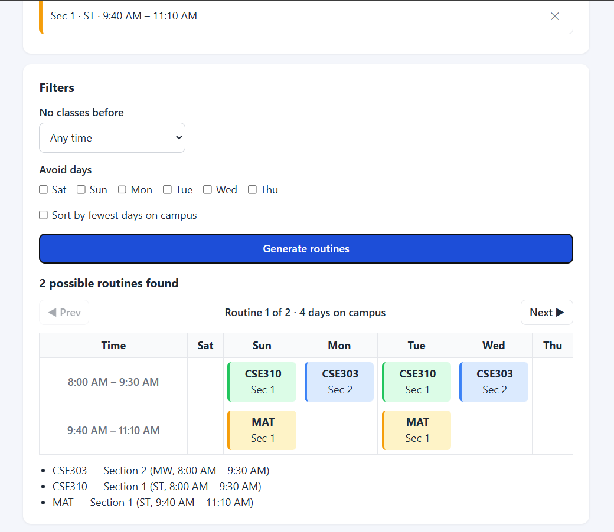

# IUB Routine Generator

A tool that helps IUB students find clash-free class routines.

**Live site:** https://sadmanmahmood3.github.io/iub-routine-generator/

## Why I built it

Finding a clash-free routine during advising is a pain. You have a list of courses, each with several sections, and you end up checking every combination by hand to see which ones overlap. This does the checking for you.

## Features

- **Clash checking:** two sections clash if they meet on the same day at overlapping times. Back-to-back classes are fine.
- **Every valid routine:** shows all clash-free combinations as a weekly timetable, with a count like "12 possible routines found".
- **Explains failures:** if nothing works, it tells you which courses clash.
- **Filters:** no classes before a chosen time, and avoid specific days.
- **Sorting:** put routines with the fewest days on campus first.
- **Saved in your browser:** your courses and filters are still there after a refresh. No login, no server.
- **Works on phones.**

## How to use it

1. Add a section: course code, section number, days and times.
   Days use IUB letters: **S** Sun, **M** Mon, **T** Tue, **W** Wed, **R** Thu, **A** Sat (e.g. `ST`, `MW`, `RA`).
   Times look like `8:00 AM`.
2. Add more sections and courses. Type the same course code again to add another section to that course.
3. *(Optional)* Set filters: earliest start time, days to avoid, or sort by fewest days.
4. Click **Generate routines** and use **Prev / Next** to browse them.

## Running it locally

There's nothing to install. Download or clone the repo and open `index.html` in your browser.

## Tests

Open `test.html` in your browser. It runs the routine logic against sample data automatically and shows each test as **PASS** or **FAIL**.

## Built with

- HTML, CSS and plain JavaScript (no frameworks)
- Developed with [Claude Code](https://claude.com/claude-code)
